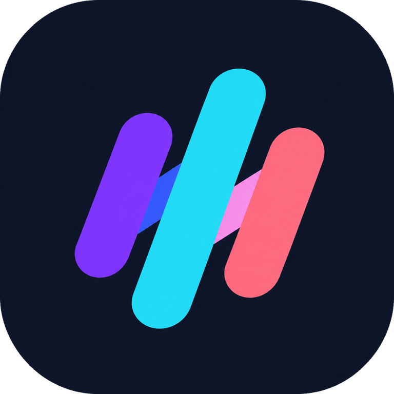
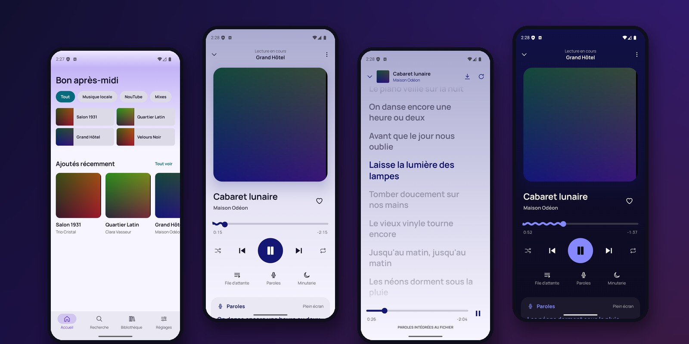
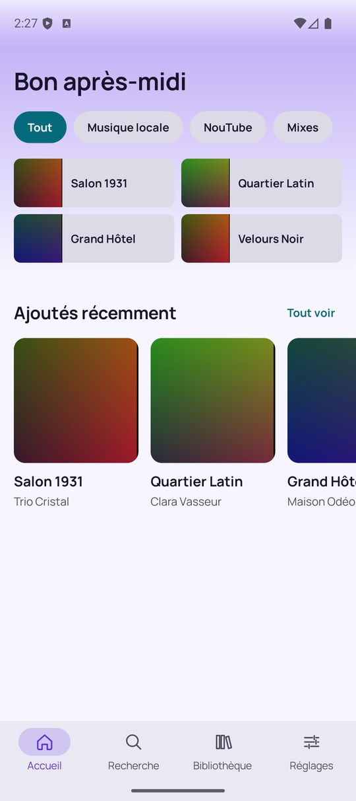
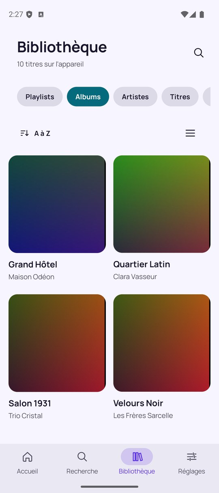
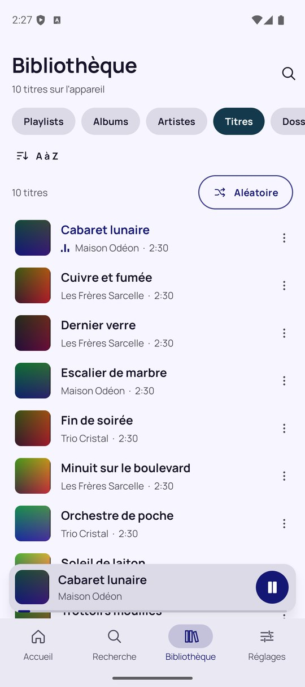
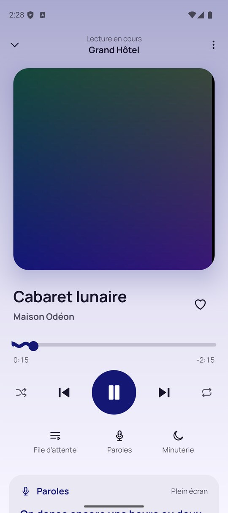
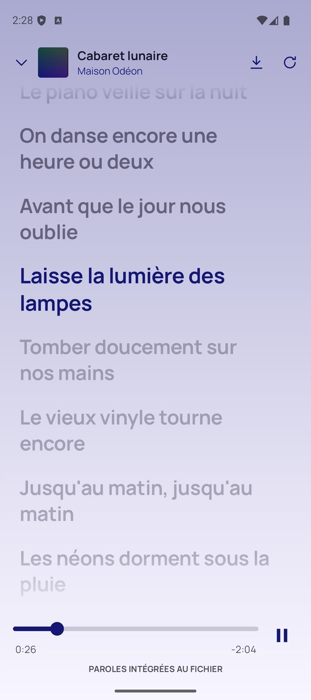
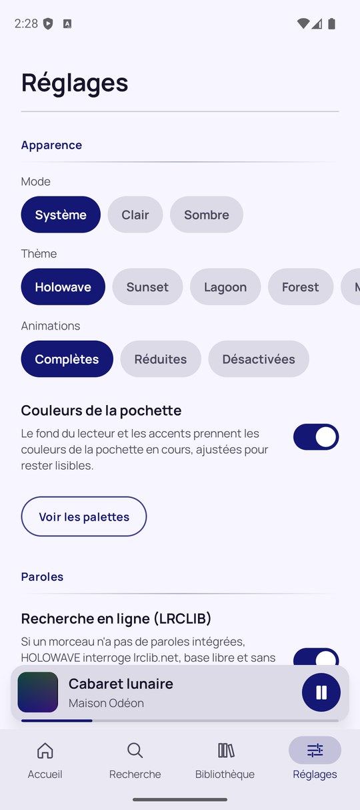
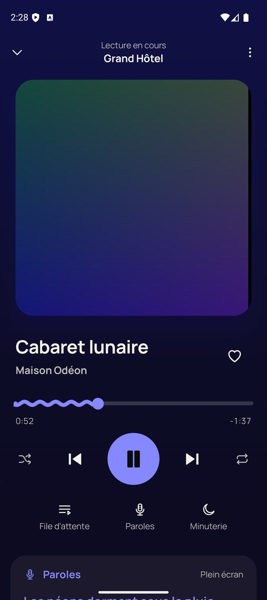
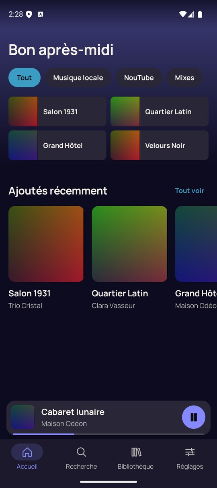

<p align="center">
  
</p>

<h1 align="center">HOLOWAVE</h1>

<p align="center">
  <b>Votre musique, vos paroles, aucun traqueur.</b><br>
  Un lecteur de musique Android hors ligne, aux couleurs de vos pochettes, avec paroles synchronisées.
</p>

<p align="center">
  <a href="https://github.com/0x80070006/HoloWave/releases/latest/download/HOLOWAVE.apk"></a>
</p>

<p align="center">
  
  
  
  
  
  
</p>

<p align="center">
  
</p>

---

HOLOWAVE lit la musique **stockée sur votre téléphone** : pas de compte, pas de streaming imposé, pas de pub. Le fond du lecteur et les accents prennent les couleurs de la pochette en cours, ajustés pour rester lisibles en clair comme en sombre.

La version 3 repense toute l'interface : cinq thèmes clair/sombre, barre à quatre onglets, mini-lecteur à gestes, lecteur plein écran, minuterie de sommeil, et un historique d'écoute local qui accueille aussi les morceaux écoutés dans [NouTube](https://github.com/nonbili/NouTube).

## Fonctionnalités

**Lecture**
- Discothèque locale indexée via MediaStore, par **albums, artistes, dossiers, titres** et **playlists**
- **Dossiers sources** : ajoutez les dossiers de votre choix (sélecteur Android) ou cochez-les dans l'arborescence détectée, mémoire interne et carte SD
- **Tous les formats audio courants** : MP3, M4A/M4B, AAC, FLAC, OGG, Opus, WAV, MKA, AMR, et **WebM** / **3GP** audio (option dans les réglages). Les formats qu'Android ne décode pas (WMA, AIFF, APE…) restent visibles, signalés « non pris en charge ».
- **Recherche des morceaux** avec progression : HOLOWAVE fait indexer par Android les fichiers audio qu'il n'avait pas repérés
- Recherche instantanée (insensible aux accents), file d'attente, aléatoire, répétition, **coups de cœur** et playlists
- **Minuterie de sommeil**

**Une interface qui s'adapte**
- **5 thèmes** : Holowave, Sunset, Lagoon, Forest et Mono+, chacun en clair et en sombre (mode système, clair ou sombre)
- **Couleurs de la pochette** : fond et accents du lecteur calculés à partir de l'album, contrastes vérifiés (AA) sur chaque thème
- **Animations** complètes, réduites ou désactivées
- Mini-lecteur à gestes, lecteur plein écran, notification et écran de verrouillage avec jaquette teintée

**Paroles synchronisées, hors ligne d'abord**
- Défilement en temps réel, ligne active mise en avant ; un tap sur une ligne y amène la lecture
- Sources essayées dans l'ordre : fichier **.lrc importé**, paroles **intégrées au fichier** (ID3 `USLT`/`TXXX`, commentaires Vorbis), **cache local**, puis **[LRCLIB](https://lrclib.net)** (base libre, sans compte ni clé d'API)
- Bouton « Tout préparer » pour télécharger d'avance les paroles de toute la discothèque

**Historique et NouTube**
- Historique d'écoute **local** (base Room dans l'espace privé de l'app), sans compteur envoyé nulle part
- Si vous l'activez, HOLOWAVE enregistre les morceaux que vous écoutez dans NouTube (capture via l'accès aux notifications, durée minimale d'écoute, titres nettoyés) et les mélange à votre bibliothèque, avec un badge « Streaming »
- Aucun code de NouTube n'est repris ; l'interopérabilité passe uniquement par les interfaces publiques d'Android ([détails](docs/noutube-interop.md))

## Captures

| Accueil | Bibliothèque | Titres |
|:---:|:---:|:---:|
|  |  |  |
| **Lecteur** | **Paroles** | **Réglages** |
|  |  |  |
| **Lecteur, thème sombre** | **Accueil, thème sombre** | |
|  |  | |

> La discothèque des captures est fictive : artistes, albums, pochettes, musiques et paroles ont été créés pour la démo.

## Sécurité et vie privée

| | |
|---|---|
| **Permissions** | lecture de l'audio (`READ_MEDIA_AUDIO`), notifications, service de lecture au premier plan. L'accès aux vidéos (`READ_MEDIA_VIDEO`) ne sert qu'aux fichiers WebM/3GP audio. Pas d'accès aux photos, contacts, localisation, ni à l'ensemble des fichiers. Les dossiers ajoutés à la main passent par le sélecteur Android, en lecture seule. |
| **Réseau** | Paroles via `lrclib.net` en HTTPS, désactivables dans les réglages. Trafic en clair interdit, réponses plafonnées, délais stricts. |
| **Données envoyées** | Titre, artiste, album et durée du morceau, rien d'autre. Aucun identifiant, aucune statistique. |
| **Stockage** | Playlists, favoris, historique et paroles restent dans l'espace privé de l'app, **exclus des sauvegardes cloud**. |
| **Capture NouTube** | Elle repose sur l'accès aux notifications, que vous accordez vous-même et pouvez retirer à tout moment. |
| **Composants exportés** | L'activité de lancement, et le service média qui refuse tout contrôleur non approuvé. Tous les `PendingIntent` sont immuables. |
| **Fichiers hostiles** | Lecteurs ID3/FLAC et LRC écrits à la main, tailles vérifiées avant allocation, tests sur les cas tronqués ou malveillants. |
| **Surface réduite** | Aucune WebView, aucun chargement de code dynamique, aucun SDK tiers hors AndroidX, Media3 et Room. R8 activé en release. |

## Installation

1. Téléchargez **[HOLOWAVE.apk](https://github.com/0x80070006/HoloWave/releases/latest/download/HOLOWAVE.apk)** depuis les [releases](https://github.com/0x80070006/HoloWave/releases).
2. Ouvrez-le sur votre téléphone (autorisez l'installation depuis cette source si Android le demande).
3. Au premier lancement, autorisez l'accès à « Musique et audio ».

Mettez vos fichiers dans le dossier **Musique** du téléphone : ils apparaissent automatiquement. Pour n'afficher que certains dossiers : **Réglages → Dossiers sources**. Si des morceaux manquent, lancez **Rechercher**.

**Astuce paroles :** pour des paroles sans jamais toucher au réseau, intégrez-les à vos fichiers (avec [Mp3tag](https://www.mp3tag.de/) ou [MusicBrainz Picard](https://picard.musicbrainz.org/)) ou importez un `.lrc` depuis l'écran des paroles.

**Capture NouTube :** dans les Réglages, activez la capture puis autorisez HOLOWAVE dans « Accès aux notifications ». Si Android affiche « Paramètre restreint », passez par « Autoriser les paramètres restreints » dans les infos de l'appli.

## Compiler

Prérequis : JDK 17+ (le JBR d'Android Studio convient) et le SDK Android 37.

```bash
./gradlew assembleDebug          # APK de debug
./gradlew testDebugUnitTest      # tests unitaires
./gradlew assembleRelease        # APK signé si keystore.properties est présent
```

Pour signer en release, créez un `keystore.properties` à la racine (ignoré par git) :

```properties
storeFile=holowave-release.jks
storePassword=…
keyAlias=holowave
keyPassword=…
```

## Architecture

**Pile technique :** Kotlin, Jetpack Compose, AndroidX Media3 (ExoPlayer et MediaSession), Room pour l'historique d'écoute, `org.json` de la plateforme. L'audit et le plan de la v3 sont dans [`docs/v3-audit-et-plan.md`](docs/v3-audit-et-plan.md).

## Crédits

- Paroles en ligne : [LRCLIB](https://lrclib.net), base libre et communautaire
- Police : Manrope, licence SIL Open Font License (voir [`licenses/`](licenses))
- Lecture audio : [AndroidX Media3](https://github.com/androidx/media)
- Interopérabilité : [NouTube](https://github.com/nonbili/NouTube) (AGPL-3.0, aucun code repris)

## Licence

Code sous licence [MIT](LICENSE).
